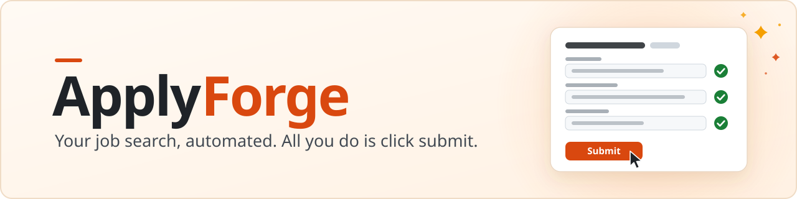
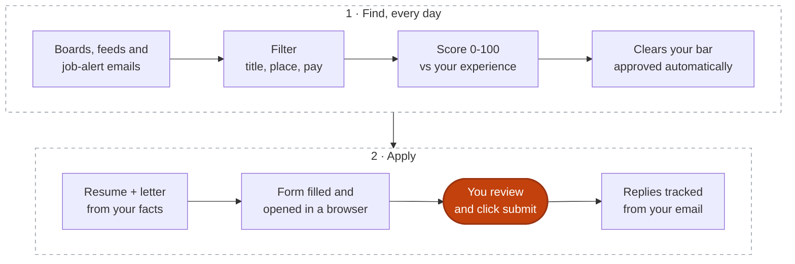

<p align="center">
  <picture>
    <source media="(prefers-color-scheme: dark)" srcset="assets/banner-dark.svg">
    <source media="(prefers-color-scheme: light)" srcset="assets/banner-light.svg">
    
  </picture>
</p>

<p align="center">
  <a href="https://github.com/ClumsyWizardHands/ApplyForge/actions/workflows/ci.yml"></a>
  
  
  
  <br>
  
  <a href="LICENSE"></a>
  
  <a href="https://ko-fi.com/clumsywizardhands"></a>
</p>

I built ApplyForge for my own job search. It runs your search every day on its
own. It finds job postings that match the roles you want, scores each one
against your experience, approves the ones that clear the bar you set, writes a resume
and cover letter for each from facts you confirmed, and opens each filled
application in a browser window. You review it as much as you like and click
submit. Replies, job alerts and recruiter messages in your email are picked up
too, if you connect it.

It runs on your own computer, and you use it by talking to Claude. The command
and the Python package are called `jobkit`, so that is the name you will see in
commands, file paths and the Claude tools.

ApplyForge is an evolving project. I keep improving it as my time and
resources allow, and what people run into decides what I work on next. The
[roadmap](#roadmap) shows where it's headed. If something trips you up,
[open an issue](https://github.com/ClumsyWizardHands/ApplyForge/issues).

## What it does

<table>
  <tr>
    <td width="50%" valign="top">
      <h3>🔎 Finds jobs every day</h3>
      On its own, at the time you choose: the public Greenhouse, Lever and Ashby boards of employers you name, Adzuna (every industry), USAJOBS (US federal), remote-job feeds, and the job-alert emails you already get.
    </td>
    <td width="50%" valign="top">
      <h3>📊 Scores them</h3>
      Filters by title, place (a city or country named in the job title counts), commute, pay floor and remote policy, keeps sites that repost other companies' jobs out, and logs why each job was dropped. Scores every job that is left 0 to 100 against your experience, lists the gaps, and checks the remote claim and the pay.
    </td>
  </tr>
  <tr>
    <td width="50%" valign="top">
      <h3>✅ Approves what clears your bar</h3>
      When you say yes in setup, every job at or above your score is approved automatically, unless a deal-breaker holds it back: a doubt about remote or location, or pay that looks unrealistic. A missing pay range doesn't. A feed job with no form to fill waits in your queue with the employer's link. You can still approve or reject any job yourself.
    </td>
    <td width="50%" valign="top">
      <h3>✍️ Writes from your facts</h3>
      A one-page resume and a cover letter for each approved job, built only from facts you confirmed and checked against them before you see anything.
    </td>
  </tr>
  <tr>
    <td width="50%" valign="top">
      <h3>📝 Opens each filled application</h3>
      Fills the form from your saved answers and opens it in a browser window. It marks what it left for you and stops at a CAPTCHA. You review and click submit.
    </td>
    <td width="50%" valign="top">
      <h3>📬 Watches your email</h3>
      Declines, interview requests and other replies, read-only, if you connect your email. LinkedIn job alerts and messages there are checked too. Thirty days of silence is marked ghosted.
    </td>
  </tr>
</table>

## Who it suits

ApplyForge works for any job titles you choose: software, nursing, teaching,
sales, operations, and so on. During setup you describe the roles you want in
your own words, and it builds your search from your answers. If you are
changing fields, say so; those jobs are then scored as a career change, with a
lower bar to reach your queue if you want one.

Where your employers post jobs decides how much ApplyForge does for each one:

- **Greenhouse, Lever and Ashby: the whole pipeline.** These are mostly tech
  companies and startups. ApplyForge reads each posting directly, scores it,
  writes the application, fills the form and tracks it.
- **Hospitals, schools, government and large employers: finding and
  scoring.** Most of them use Workday, iCIMS, Taleo or SuccessFactors.
  Reading Workday, iCIMS and Taleo through their documented feeds is an idea
  on the [roadmap](#roadmap). Today:
  - turn on Adzuna, which covers every industry and can search near your town
    (free key);
  - use USAJOBS for US federal jobs (also a free key);
  - connect your email: jobs in your job-alert emails from employers that
    also post on Greenhouse, Lever or Ashby are found there; the rest are
    listed in your digest;
  - turn on LinkedIn discovery, which finds employers that also post on
    Greenhouse, Lever or Ashby;
  - paste the job link to Claude. ApplyForge names the system when it
    recognizes the link, and you apply on the employer's site. Tracking those
    applications, and reading Workable and SmartRecruiters boards, are on the
    roadmap.

  Feeds such as Adzuna often send only a snippet of a posting. A job with too
  little description to score goes in the digest with its link so you can
  open it.

A few more things:

- It's set up for US job searches today (pay floors, USAJOBS, the location
  table). Other countries are on the roadmap.
- Pay floors are yearly. If you are paid by the hour, setup converts your rate.
- The more detail your resume has, the better the applications. Setup tells
  you where yours is thin, and the daily questions fill gaps over time.

## Get started

Bring the Claude app or Claude Code, and a Claude subscription or an Anthropic
API key. Setup installs the rest. I built and tested ApplyForge on my Mac, and
the tests also run on Linux. On Windows, give it a go and
[tell me](https://github.com/ClumsyWizardHands/ApplyForge/issues) what trips
you up.

In Claude Code, say:

> Clone https://github.com/ClumsyWizardHands/ApplyForge into ~/code/jobkit and set it up

Tip from my own setup: keep the checkout in a plain folder like `~/code`.
macOS hides Desktop, Documents, Downloads and iCloud Drive from scheduled jobs,
so the daily run can't reach files there.

Claude then runs the setup interview that ships with the repo. To start it
yourself, open a Claude session in that folder and say "set up jobkit". It
asks one question at a time, takes about an hour, and saves each answer as you
go:

1. Check your computer and install what is missing, each install on your yes.
2. Read your resume (PDF, Word, HTML, plain text, or pasted).
3. Go through your experience line by line. You keep, edit or drop each line,
   and say how solid each number is and where it could be shown.
4. Ask what you want: the kinds of role, places, remote or not, pay (yearly or
   hourly), what to avoid, whether this is a change of field, and whether jobs
   that clear your bar are approved without asking you, and at what fit score
   (75 is the suggestion). Then whether the filled applications open for you
   after each daily run (yes by default).
5. Ask which employers to watch, or note that you will rely on the job feeds.
6. Ask the questions application forms always ask: work authorization, notice
   period and so on. The demographic questions are optional.
7. Run a first search.
8. Set up the daily run as a scheduled task in the Claude app, and connect
   your email if you like.

Stop whenever you like; say "continue jobkit setup" to pick up where you left
off. [Setup](docs/setup.md) covers doing each step by hand.

## A normal day



1. **It runs every day on its own**, at the time you chose, as a scheduled task
   in the Claude app (or when you next open the app, if it was closed).
2. **It finds and scores jobs.** It checks the boards and feeds, drops what
   your filters rule out, and scores the rest against your experience.
3. **It approves the ones that clear the bar you set in setup** (on your
   yes). You can still approve or reject anything yourself.
4. **It writes the resume and letter** for each approved job, from your
   confirmed facts only.
5. **It opens each filled application** in a browser window at the end of the
   run (setup asks; yes is the default).
6. **You review as much as you like and click submit.**
7. **Replies are tracked from your email,** if you connected it: declines,
   interview requests and the rest. No reply after 30 days is marked ghosted.
8. **Your LinkedIn job alerts and messages are checked too,** if you connected
   your email. Each job in an alert is looked up on the employer's own
   Greenhouse, Lever or Ashby board, and is scored the same day when it's
   there. Recruiter messages show up in your summary.

How a job alert becomes an application: an email lists jobs you'd fit. Claude
reads it. ApplyForge looks up each job on the employer's own Greenhouse, Lever
or Ashby board. When it's there and fits your filters, it is scored the same
day and approved if it clears your bar. If a job isn't on a board ApplyForge
reads, Claude searches the web for it and, when it's on Workday or a similar
site, gives you the direct link.

Claude sends a short summary after each run. Open the jobkit folder in Claude
whenever you like. Here is a morning (the companies and people are made up):

```text
You:     what's in the queue

Claude:  This morning's run finished at 07:12. 3 applications cleared your
         bar and are open in your browser:

         · Northwind Health · Operations Manager · $95–118k · remote ✓ · 88
         · Larkspur Labs · Program Manager · $105–130k · remote ✓ · 81
         · Brightwater Freight · Customer Success Lead · $82–96k · hybrid · 78
           from your LinkedIn job alert, found on Brightwater's own board

         Reply: Haulmark Logistics invited you to an interview.
         LinkedIn message: a recruiter at Cedar & Pine asked whether
         you're open to an operations role.

         Below your bar, in your queue:
         1. Cedar & Pine · Office Lead · $58–64k · remote ✓ · 66
            ⚠ remote-conflict: "must live within 30 miles of our Denver office"

         2 questions for you today.

You:     reject 1, not really remote. I submitted Northwind and Larkspur.

Claude:  Rejected 1 (not really remote). Logged Northwind and Larkspur as
         submitted; their replies will be picked up from your email.
```

Other things to say: "approve 2", "check my email", "questions for me".

## What it does and what you do

| ApplyForge | You |
|---|---|
| runs every day on its own | set your bar once in setup |
| finds and scores jobs, and approves the ones that clear your bar | approve or reject anything else, when you want to |
| writes the resume and letter from your confirmed facts | read them as closely as you like |
| fills the application form and opens it in a browser window | review it and click submit |
| asks for facts it doesn't have | answer occasional questions in your own words, and confirm before anything is saved |
| stops at a CAPTCHA, an ID or payment field, or an assessment | handle those yourself |
| records replies, job alerts and recruiter messages from your email, if you connect it | decide what to do next |

## Why you click submit

ApplyForge fills each application and opens it for you. Clicking submit is
yours. Many employers put a CAPTCHA or another bot check on their application
forms. That check is the employer asking for a person to send the
application. Some of these checks are invisible, so software can't reliably
tell which forms have one. The way to respect all of them is for a person to
click submit every time. When a form shows a challenge, ApplyForge stops and
leaves it for you. It never solves or gets around one.

There is also no way for an applicant's software to submit through the job
systems themselves. Greenhouse, Lever, Ashby and SmartRecruiters accept
applications through their APIs only with a key issued to the employer.
Submitting for you would mean clicking the employer's button in a browser,
which is what those checks are there to stop.

My guess at where this goes: as more applications come from bots, more employers will put checks on their forms and screen out what looks mass-produced. An application you read and sent yourself should hold up better whichever way that goes. If employers ever offer an approved way for software to apply on your behalf, that's consent, and ApplyForge could use it.

## Replies in your email (optional)

If you have connected your email to Claude (for example with the Gmail
connector), Claude checks your inbox for you, on every daily run and whenever
you say "check my email":

- **Replies to your applications:** an automatic receipt, a rejection, an
  assessment, an interview invitation, an offer, or a recruiter's question.
- **Job-alert emails** from LinkedIn and the job sites, each job handled as in
  [A normal day](#a-normal-day). A job only on LinkedIn never enters
  ApplyForge.
- **LinkedIn message notifications:** the sender's company and one line about
  who wrote and what they want, in your summary. Answering is yours.

Email is read-only: Claude reads, ApplyForge records, and nothing is sent,
deleted, labelled or moved. ApplyForge itself never connects to your mailbox,
and no link in an email is opened. For each reply it stores the outcome, the
date, the message's id and link, and a one-line summary in Claude's words,
never the text of the email. The daily run checks when `tracking.email_check`
is true in `config/filters.yaml` (the setup interview sets it). Without a
connector, tell Claude what you heard back and it records that.
[Email replies](docs/email-responses.md) has the details.

## Where your data is kept

Your resume facts, form answers, preferences and job database stay on your
machine, in files git ignores. `git pull` leaves them alone and they are never
committed. The repository holds only the program and the templates.

What leaves your computer:

- requests to public job boards and job feeds. Each request names a contact
  email address (`JOBKIT_CONTACT_EMAIL` in `.env`, or else the email from your
  application answers), as those services ask automated clients to do;
- what you type into application forms, and the files you attach. Some forms
  read an attached resume as soon as it is uploaded, before you submit;
- what Claude reads: the setup interview, and the postings and parts of your
  experience that ApplyForge sends it to score jobs and write applications;
- with LinkedIn discovery on, a few logged-out searches a day, which also
  include that contact email address;
- if you connect your email, the sender, subject, date and preview of emails
  about your applications, which Claude reads to record replies. When you ask
  Claude to check your email, it may open a whole message if the preview
  isn't enough. The scheduled daily run reads only the sender, subject, date
  and preview, and opens a job-alert email only to read its list of jobs.

## LinkedIn

ApplyForge reads employers' own job boards, and never logs in to LinkedIn.
LinkedIn reaches it two ways:

- **Your job-alert emails and messages**, read from your own mailbox if you
  connect it. Each job in an alert is looked up on the employer's own board,
  and a recruiter's message shows up in your summary. The LinkedIn site is never
  opened for this.
- **Discovery mode** (off until you turn it on): a few logged-out LinkedIn
  searches a day find company names, and those jobs are then found on each
  company's own board. LinkedIn's terms forbid automated access, so this stays
  your choice.

[LinkedIn](docs/why-no-linkedin.md) covers how both work and what else I'm
looking at for LinkedIn.

## Costs

- **Claude.** ApplyForge calls Claude to score jobs (a small, inexpensive
  model) and to write and check applications (a larger model). With a Claude
  subscription, these calls go through Claude Code and count toward your
  plan's usage. If your Claude login expires, the run and `jobkit doctor` say
  so: run `claude`, then type `/login`. With an API key in `.env`, you pay per
  call: expect roughly $0.15 to $0.40 per tailored application, and a small
  fraction of that to score a job.
- **Job feeds.** Adzuna and USAJOBS need free keys. The other feeds and the
  company boards need none.

## Roadmap

What I'd like to add, as my time and resources allow. Your pain points move
things up the list. The full list, with the status of each item, is in
[docs/roadmap.md](docs/roadmap.md).

| Theme | Ideas and plans |
|---|---|
| More places to find jobs | paste a job description from any site, and Workable and SmartRecruiters boards (planned); Workday, iCIMS and Taleo feeds, and job searches outside the US (ideas) |
| Setup and daily use | reply drafts you edit and send yourself, and saved sign-ins for application sites, with your permission for each site (ideas) |
| More AI tools | OpenAI's Codex: project rules, skills and the jobkit tools (planned); the daily run in the ChatGPT desktop app, and OpenAI's dots (exploring); other assistants that use MCP tools (idea) |
| Better results in other fields | the fact checker learns nursing, teaching, trades and public-sector wording, and hourly pay ranges (planned) |
| LinkedIn, within the principles | your LinkedIn job-alert emails and messages, read-only (done); who you know at a company, from your own data export (idea) |
| More computers | `jobkit schedule` on Linux (planned); `jobkit schedule` and the tests on Windows (ideas) |

Some things stay fixed: you click submit, ApplyForge never solves or gets around
a CAPTCHA, everything it writes comes from facts you confirmed, email is
read-only, LinkedIn stays logged out, and your files and job database stay on
your computer.

## Updating

To update, close any open Claude sessions in the jobkit folder, then run:

```bash
cd ~/code/jobkit && git pull && uv sync && uv run jobkit doctor
```

Start a fresh session afterwards so the jobkit tools load the new code.
ApplyForge changes often; [what's new](docs/changelog.md) lists what changed.

## More detail

- [Setup](docs/setup.md): installing by hand, `jobkit doctor`, your files,
  keys, the schedule and the Claude tools registration
- [How it works](docs/how-it-works.md): filters, role tracks, scoring,
  tailoring, questions, the nightly run and tracking
- [Fact checks](docs/validators.md): how every resume, letter and answer is
  checked against your confirmed facts
- [Form filling](docs/form-filling.md): what gets filled, what is left for you,
  and when filling stops
- [Commands and tools](docs/commands.md): every `jobkit` command and Claude tool
- [Email replies](docs/email-responses.md) and [LinkedIn](docs/why-no-linkedin.md)
- [Roadmap](docs/roadmap.md) and [what's new](docs/changelog.md)
- [Contributing](docs/contributing.md): pain points, ideas, tests, the build
  spec and the project rules
- [License](LICENSE): MIT

## Support

Your support means a lot: https://ko-fi.com/clumsywizardhands

And to those of you coming to this page experiencing similar struggles to mine, may you find your way through the dark.

Live long and prosper, friends.
